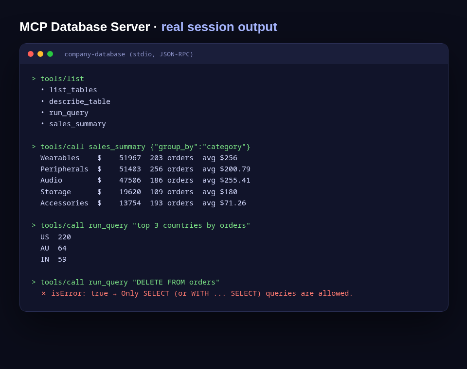

# MCP Database Server: let Claude or ChatGPT safely query your company data

[](https://m8ven.ai/mcp/saadrupai/mcp-database-server?s=readme)

A **Model Context Protocol (MCP)** server that gives AI assistants such as Claude Desktop, Claude Code and Cursor **read-only** access to a business database. Ask *"What was revenue by category last quarter?"* in plain English, and the AI explores the schema, writes the SQL and answers. It **cannot change or delete anything**.

> Open-source demo project by [Saad Rupai](https://github.com/saadrupai), a backend engineer who builds AI agents, integrations and data systems.



## Why MCP?

MCP is the open standard for connecting AI assistants to tools and data. One MCP server works with every MCP-compatible client, so you don't need a separate integration for each AI app.

## Tools exposed to the AI

| Tool | What it does |
|---|---|
| `list_tables` | All tables with row counts |
| `describe_table` | Columns, types, primary and foreign keys, and 3 sample rows |
| `run_query` | Read-only SQL (SELECT/WITH only), capped at 200 rows |
| `sales_summary` | Ready-made report: revenue, orders and average order value by month, product, category or country |

## Safety: three layers of defense

1. **Query guard:** a single statement only, SELECT/WITH only. It blocks `INSERT/UPDATE/DELETE/DROP/ATTACH/PRAGMA` and other write keywords, and comments and string literals are stripped first so the check can't be tricked.
2. **Read-only connection:** the database is opened with `readOnly: true`. Even a query that got past the guard couldn't write (there's a test for this).
3. **Row cap:** every query is wrapped in an outer `LIMIT`, so the AI can't dump a whole table.

Errors are returned to the AI as tool errors (`isError: true`), so it can fix its own SQL instead of crashing the session.

## Use it

Requires Node 22.18+, with **zero npm dependencies**. On first run it creates a demo e-commerce database (customers, products, orders).

**Claude Code**
```bash
claude mcp add company-db -- node /path/to/mcp-database-server/src/index.ts
```

**Claude Desktop / Cursor** (`claude_desktop_config.json` / `mcp.json`)
```json
{
  "mcpServers": {
    "company-db": {
      "command": "node",
      "args": ["/path/to/mcp-database-server/src/index.ts"],
      "env": { "DB_PATH": "/path/to/your.db" }
    }
  }
}
```

Then ask: *"Which product category makes the most money?"* or *"Who are our top 5 customers by spend?"*

## Use it as an agent skill

`skills/company-db/SKILL.md` is a ready-made skill that tells the agent when to use this server and how: explore the schema first, count only paid orders, convert cents, aggregate in SQL and sanity-check results before answering. In Claude Code, copy it into your skills folder:

```bash
mkdir -p ~/.claude/skills && cp -r skills/company-db ~/.claude/skills/
```

## Tests

```bash
npm test
```

The tests cover the guard (allowed queries, blocked writes, multi-statement and comment tricks), every tool, the read-only connection, and a real MCP session over stdio (`initialize` → `tools/list` → `tools/call` → error codes).

## Adapting it to your stack

The protocol layer (`src/mcp.ts`) is independent of the database. I adapt this pattern to **PostgreSQL, MySQL, BigQuery, Supabase, Airtable, HubSpot, Stripe**, internal REST APIs and more, with per-table permissions, audit logs and auth for remote (HTTP) MCP deployments.

## Need an MCP server or AI integration for your business?

You can reach me on [Fiverr](https://www.fiverr.com/saadrupai69).

MIT License
